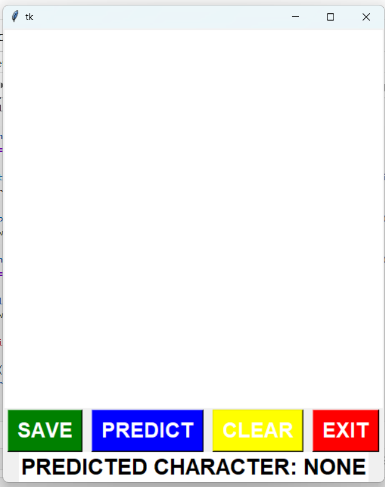
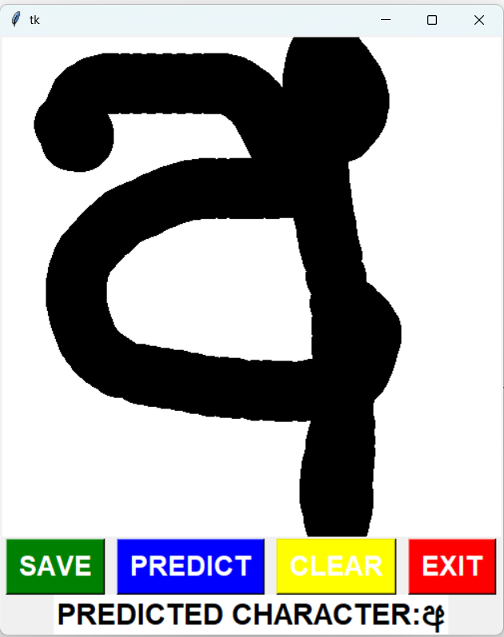

# sinhala-handwritten-character-recognition
A Python machine learning project for recognizing handwritten Sinhala characters using KNN, OpenCV and a Tkinter graphical user interface.

## Project Overview

Sinhala Handwritten Character Recognition is a Python-based machine learning project designed to recognise handwritten Sinhala characters. Sinhala is one of the official languages of Sri Lanka.

The application uses a K-Nearest Neighbours (KNN) classification model to predict handwritten characters drawn by users through an interactive graphical user interface (GUI).

This project represents my first practical machine learning project, focusing on handwritten character recognition, image processing, classification and GUI development.

The current version supports four Sinhala characters and provides a foundation for developing a more accurate and comprehensive character recognition system.

## Project Objectives

- Understand the fundamentals of machine learning.
- Explore handwritten character recognition.
- Prepare and process image datasets.
- Apply the K-Nearest Neighbours classification algorithm.
- Integrate a machine learning model into a graphical user interface.
- Identify technical limitations and opportunities for improvement.

## Supported Characters

The current version supports the following four Sinhala characters:

| Sinhala Character | Class Label |
|:----------------:|:-----------:|
| අ | 0 |
| එ | 1 |
| ඉ | 2 |
| උ | 3 |

## Application Screenshots

The application provides an interactive drawing canvas where users can draw handwritten Sinhala characters and receive predictions.

| Drawing Interface | Character Prediction |
|:-----------------:|:--------------------:|
|  |  |
| Initial application interface | Handwritten character prediction result |

For better prediction results, users should draw the character large enough to occupy most of the available drawing canvas.

## Key Features

- Interactive handwritten character drawing canvas.
- Recognition of four Sinhala characters.
- KNN-based machine learning predictions.
- Image preprocessing using OpenCV.
- Handwritten image saving functionality.
- Canvas clearing functionality.
- Real-time display of prediction results when requested.
- Integration of a saved machine learning model with a desktop GUI.

## Technologies Used

| Technology | Purpose |
|------------|---------|
| Python | Main programming language |
| NumPy | Numerical and array operations |
| OpenCV | Image preprocessing and resizing |
| Scikit-learn | Machine learning and classification |
| Tkinter | Graphical user interface development |
| Pillow | Image creation and manipulation |
| Jupyter Notebook | Code development and experimentation |
| Anaconda | Python development environment |
| GitHub | Version control and project documentation |

## Project Workflow

The project is organised into three main development stages.

### Stage 1 - Dataset Creation

- Collect handwritten Sinhala character images.
- Organise images according to character classes.
- Prepare image data for machine learning.

### Stage 2 - Model Training

- Load and preprocess the dataset.
- Convert image data into numerical features.
- Explore K-Nearest Neighbours classification.
- Save the trained model for character prediction.

### Stage 3 - GUI Development and Prediction

- Create an interactive drawing canvas using Tkinter.
- Capture handwritten character input.
- Resize and preprocess the input image.
- Pass the processed image to the saved KNN model.
- Display the predicted Sinhala character.

## Project Structure

```
sinhala-handwritten-character-recognition/
│
├── .gitignore
├── 1step-dataset-creation.ipynb
├── 2-step-model-training.ipynb
├── 3-step_sinhala_character_prediction_GUI.ipynb
├── dataset.zip
├── sinhala-character-knn.sav
├── gui-interface.png
├── gui-prediction.png
└── README.md
```

## File Descriptions

| File | Description |
|------|-------------|
| 1step-dataset-creation.ipynb | Handwritten character dataset creation |
| 2-step-model-training.ipynb | Machine learning model training |
| 3-step_sinhala_character_prediction_GUI.ipynb | GUI development and character prediction |
| dataset.zip | Compressed handwritten character dataset |
| sinhala-character-knn.sav | Saved KNN classification model |
| gui-interface.png | Screenshot of the initial GUI |
| gui-prediction.png | Screenshot of a character prediction |
| README.md | Project documentation |
| .gitignore | Excludes unnecessary files from version control |

## Installation and Usage

### Prerequisites

- Python 3
- Jupyter Notebook or Anaconda
- Required Python libraries

### Step 1 - Download the Project

Clone or download the repository using GitHub.

Extract the dataset.zip file into the project directory if you intend to work with the training dataset.

### Step 2 - Install Dependencies

Open Anaconda Prompt or a terminal and run:

```bash
pip install numpy opencv-python pillow scikit-learn jupyter
```

Tkinter is generally included with standard Python installations.

### Step 3 - Launch Jupyter Notebook

```bash
jupyter notebook
```

### Step 4 - Run the Application

Open the following notebook:

```
3-step_sinhala_character_prediction_GUI.ipynb
```

Run the notebook cells to launch the graphical user interface.

### Step 5 - Predict a Character

1. Draw one of the four supported Sinhala characters.
2. Ensure the character occupies most of the drawing canvas.
3. Click the PREDICT button.
4. View the predicted Sinhala character.
5. Click CLEAR to try another character.

## GUI Controls

| Button | Function |
|--------|----------|
| SAVE | Save the handwritten character image |
| PREDICT | Predict the handwritten character |
| CLEAR | Clear the drawing canvas |
| EXIT | Close the application |

## Model Performance

The current KNN model demonstrates the ability to recognise and predict four handwritten Sinhala characters.

However, prediction accuracy is not yet consistent across different handwriting styles, character sizes and positions.

A reliable accuracy percentage has not yet been established through formal model evaluation.

Further testing and image preprocessing improvements are required to improve the overall recognition performance.

## Current Limitations

- Recognition is limited to four Sinhala characters.
- Prediction accuracy requires further improvement.
- Predictions are sensitive to character size and positioning.
- Users must draw characters across most of the available canvas for better results.
- Contour detection has not yet been implemented.
- Automatic character cropping and centring are not currently supported.
- The current image resolution may limit the amount of character detail available to the model.
- Further testing with different handwriting styles is required.

## Future Improvements

### Image Processing

- [ ] Implement contour detection using OpenCV.
- [ ] Automatically identify character boundaries.
- [ ] Crop handwritten characters using bounding boxes.
- [ ] Centre characters before prediction.
- [ ] Improve image normalisation.
- [ ] Explore higher image resolutions.

### Machine Learning

- [ ] Expand the handwritten character dataset.
- [ ] Collect samples from different individuals.
- [ ] Support additional Sinhala characters.
- [ ] Optimise KNN model parameters.
- [ ] Implement data augmentation.
- [ ] Explore alternative classification algorithms.
- [ ] Explore Convolutional Neural Networks (CNNs).

### Model Evaluation

- [ ] Establish model accuracy.
- [ ] Calculate precision, recall and F1-score.
- [ ] Generate a confusion matrix.
- [ ] Evaluate different handwriting styles.
- [ ] Compare the performance of different machine learning models.

### Application Development

- [ ] Improve the graphical user interface.
- [ ] Improve prediction consistency.
- [ ] Explore a web-based character recognition application.

## Learning Outcomes

Through this project, I gained practical experience in:

- Python programming.
- Machine learning fundamentals.
- Dataset creation and preparation.
- Image preprocessing.
- Computer vision.
- K-Nearest Neighbours classification.
- Graphical user interface development.
- Machine learning model integration.
- Debugging and technical problem-solving.
- Identifying system limitations.
- Project documentation and GitHub version control.

## Development Roadmap

| Version | Development | Status |
|---------|-------------|--------|
| V1.0 | Basic Sinhala character recognition | Completed |
| V1.1 | Contour detection and automatic cropping | Planned |
| V1.2 | Improved dataset and image preprocessing | Planned |
| V1.3 | Model performance evaluation | Planned |
| V2.0 | Advanced machine learning and CNN exploration | Planned |
| V3.0 | Expanded Sinhala character recognition | Future Development |

## Project Status

**Version 1.0 - Completed Working Prototype**

The application successfully demonstrates basic handwritten Sinhala character recognition using machine learning.

Although the current implementation has limitations, it provides a foundation for future improvements in image preprocessing, model accuracy and character recognition capabilities.

## Acknowledgements

This project was developed with academic guidance and learning resources as part of my machine learning learning journey.

Academic materials and any provided training resources are acknowledged as supporting resources for this project.

## Author

**Aloka Fernando**

Bachelor of Information Technology Student

Aspiring Data Analyst

### Areas of Interest

- Data Analytics
- Data Science
- Machine Learning
- Artificial Intelligence

---

Developed in 2026 as part of my personal technical portfolio and continuous learning journey.
